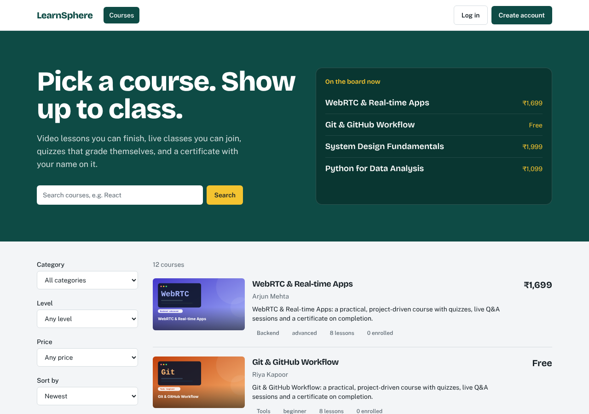
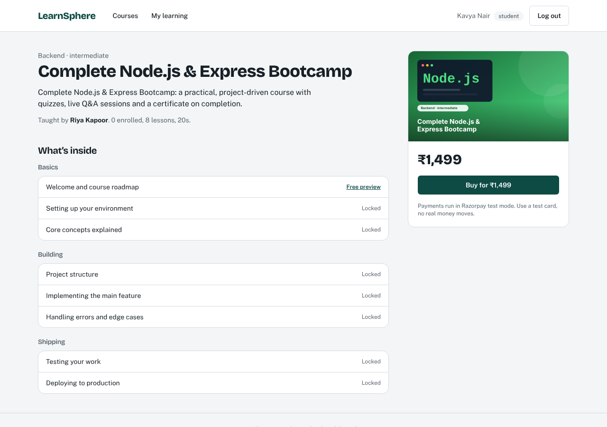
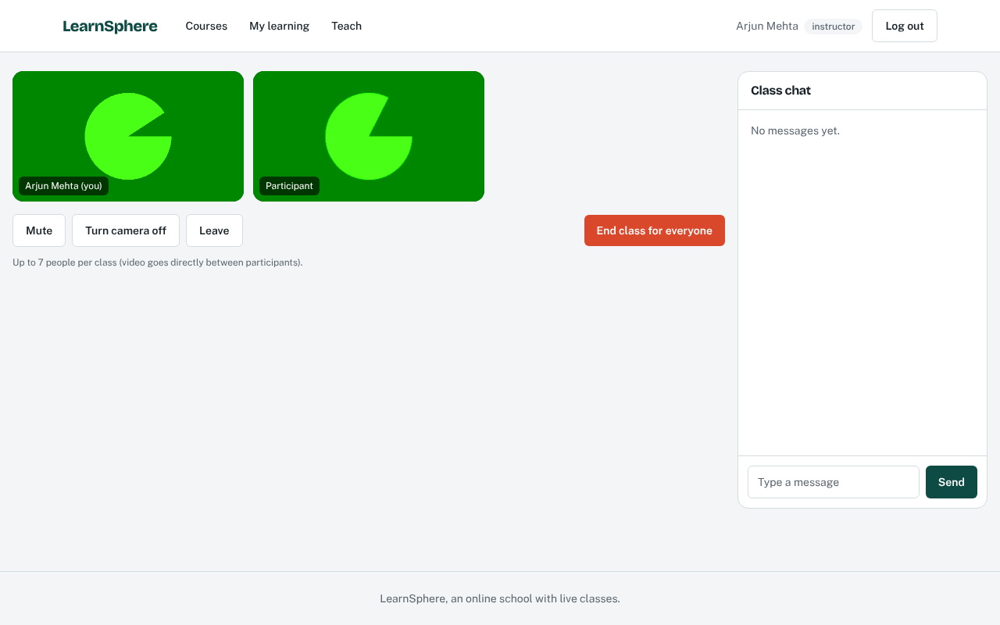

# LearnSphere

An online learning platform (MERN) with video lessons, live classes, quizzes and certificates. Students browse and enroll in courses, watch adaptive video, join live classes over WebRTC, take auto-graded quizzes and download a PDF certificate. Instructors upload videos, build courses and quizzes and see their earnings. Admins review courses and manage users. Payments run through Razorpay in test mode.

This is project **FS-03**. The repository also holds **FS-01** (ShopSphere) in its own folder.

**Live demo:** https://nexvia-capstones.vercel.app
**API health check:** https://learnsphere-api-jzdc.onrender.com/api/health

The API is on Render's free plan and sleeps when idle, so the first request after a pause can take about a minute.

Demo logins (password `Demo@1234`): `student@learnsphere.dev`, `instructor@learnsphere.dev`, `admin@learnsphere.dev`.

## Screenshots

Taken from a local run with the seeded demo data.

| | |
| --- | --- |
|  |  |
|  |  |
|  |  |

## What the brief asked for and where it lives

| Requirement | Where |
| --- | --- |
| Roles (student, instructor, admin), course, lesson and enrollment models | `server/src/features/*/*.model.js`, role checks in `server/src/shared/middleware/auth.js` |
| Video upload, FFmpeg in a BullMQ job, streaming formats | `server/src/features/video/` (queue, worker, processor, ffmpeg helpers) |
| Video delivery through CloudFront | `server/src/shared/storage/` (S3 adapter, CloudFront signed URLs and cookies, signed local fallback) |
| Quizzes, auto-grading, progress | `features/quizzes`, `features/progress` |
| Live classes with WebRTC and chat | `features/liveclasses` (Socket.IO signaling), `client/src/pages/LiveRoom.jsx` |
| PDF certificates | `features/certificates` (pdfkit, public verify page) |
| Payments and instructor earnings | `features/payments` (Razorpay), `features/earnings` |
| Redux Toolkit | `client/src/app/slices.js` |
| Feature-based monolith | one Express app, one folder per feature |

## Tech stack

- **Client:** React 19, Vite, Tailwind CSS, Redux Toolkit, React Router, hls.js, Recharts
- **Server:** Node.js, Express 5, Mongoose, zod, JWT with refresh-token rotation, Socket.IO, pdfkit
- **Data and jobs:** MongoDB (Atlas in production), Redis with BullMQ, FFmpeg
- **Storage:** local disk or AWS S3 behind one adapter interface, CloudFront signed delivery
- **Payments:** Razorpay in test mode (order, signature check, webhook)
- **Tests:** Jest and Supertest (server), Vitest (client), Playwright (browser)
- **Deployment:** Docker, Render (API), Vercel (client), MongoDB Atlas

## Run it locally

With Docker (Mongo, Redis, API, worker and client together):

```bash
cp .env.example .env        # optional, defaults work for a local try
docker compose up --build
```

Open http://localhost:8080. The database is seeded on first start (12 courses, quizzes and one real processed demo video).

Without Docker you need Node 20+, MongoDB, Redis and FFmpeg:

```bash
cd server
cp .env.example .env
npm install
npm run seed -- --video     # demo users, courses, quizzes and a processed video
npm run dev                 # API and inline video worker on :5000, Swagger at /api/docs

cd ../client
npm install
npm run dev                 # http://localhost:5173
```

## Scripts

| Where | Command | What it does |
| --- | --- | --- |
| server | `npm run dev` / `npm start` | run the API (inline video worker when `RUN_WORKER_INLINE=true`) |
| server | `npm run worker` | stand-alone video worker |
| server | `npm run seed -- --video` | demo data and a processed demo video |
| server | `npm test` | 73 Jest tests |
| client | `npm test` | 10 Vitest tests |
| client | `node scripts/make-thumbs.mjs` | regenerate the course thumbnails in `public/thumbs` |
| e2e | `python e2e/e2e_student_flow.py` | browser test of the student flow (Playwright) |

## Environment variables

Examples are in `server/.env.example`, `client/.env.example` and the root `.env.example` (for Docker Compose). Never commit a real `.env`.

## Documentation

- [Architecture](docs/ARCHITECTURE.md): structure, data model and main flows
- [Deployment](docs/DEPLOYMENT.md): Atlas, Redis, Render, Vercel, Razorpay, S3 and CloudFront
- [Test results](docs/TEST_RESULTS.md): what was run, numbers and known limits
- [Presentation](docs/PRESENTATION.md): 10-minute plan and demo script
- [Reflection](docs/REFLECTION.md): what I did, what I learned and what is missing
- [Learning notes](docs/LEARNING_NOTES.md): how each module works
- API reference: run the server and open `/api/docs`

## Known limits

- Razorpay runs in test mode only. There is no real payout to instructors.
- I do not have an AWS account. The S3 and CloudFront code is covered by unit tests with a fake client, but it has not been run against real AWS. The live site uses local disk storage, so videos uploaded on the live site disappear when the server restarts. The demo video is rebuilt automatically at start-up.
- Live classes use a WebRTC mesh with STUN only. That is fine for a few people on normal networks and will not work behind strict NATs without a TURN server.
