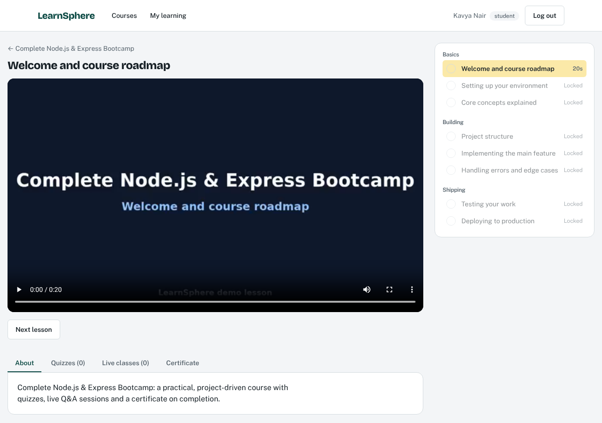
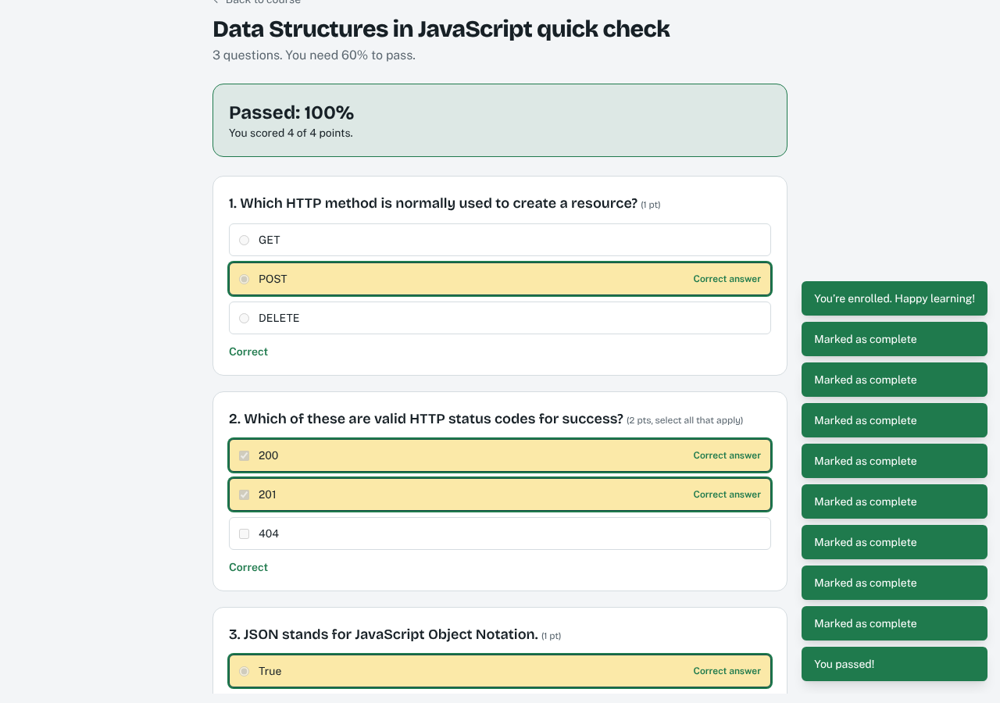
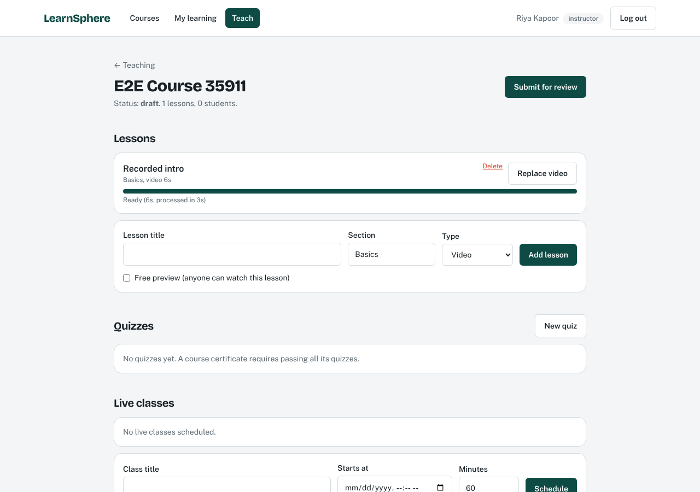
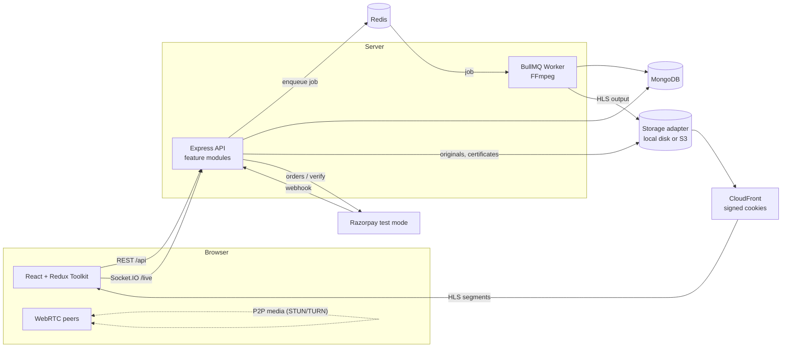
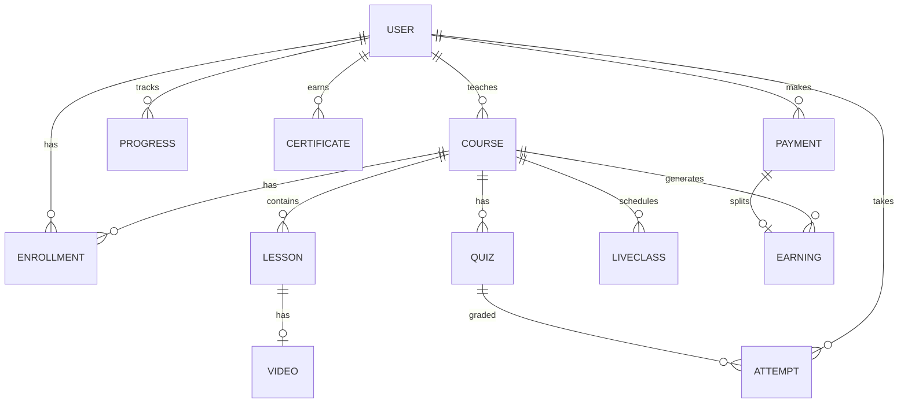

# LearnSphere

LearnSphere is an online school built with the MERN stack. Students browse and buy courses, watch adaptive video lessons, join live classes over WebRTC, take auto-graded quizzes and download a PDF certificate. Instructors upload videos, build courses and quizzes, schedule live classes and follow their earnings. Admins review courses and manage users. Payments run through Razorpay in test mode.

This is project **FS-03**. The repository also holds **FS-01** (ShopSphere) in its own folder.

| | |
| --- | --- |
| Live demo | https://nexvia-capstones.vercel.app |
| API health check | https://learnsphere-api-jzdc.onrender.com/api/health |
| API reference | `/api/docs` on the running server (Swagger UI) |

The API runs on Render's free plan and sleeps when idle, so the first request after a pause can take about a minute.

Demo logins (password `Demo@1234`):

| Role | Email |
| --- | --- |
| Student | `student@learnsphere.dev` |
| Instructor | `instructor@learnsphere.dev` |
| Admin | `admin@learnsphere.dev` |

Razorpay test mode: card `5267 3181 8797 5449`, any future expiry, any CVV (or UPI `success@razorpay`).

## Screenshots

Taken from a local run with the seeded demo data.

| | |
| --- | --- |
|  |  |
|  |  |
|  |  |

## Features

**Students**
- Search the catalog and filter by category, level and price; sort by newest or price.
- Enroll in free courses, pay for paid courses with Razorpay.
- Watch HLS video with two quality levels (360p and 720p); free preview lessons play without enrolling.
- Progress per lesson and per course.
- Quizzes with single choice, multiple choice and true/false questions, graded on the server, with a pass mark.
- A PDF certificate on completion, with a public page where anyone can verify it by its ID.
- Join live classes with video, audio and chat.

**Instructors**
- Create and edit courses, sections and lessons.
- Upload a lesson video and watch it go from queued to processing to ready.
- Quiz builder.
- Schedule, start and end live classes.
- Submit a course for review.
- Earnings dashboard (80% to the instructor, 20% to the platform).

**Admins**
- Approve or reject submitted courses.
- Activate or deactivate users and change roles.
- Platform statistics.

## Requirements and where they live

| Requirement | Where |
| --- | --- |
| Roles, course, lesson and enrollment models | `server/src/features/*/*.model.js`, role checks in `server/src/shared/middleware/auth.js` |
| Video upload, FFmpeg in a BullMQ job, streaming formats | `server/src/features/video/` |
| Video delivery through CloudFront | `server/src/shared/storage/` (S3 adapter, CloudFront signed cookies, signed local fallback) |
| Quizzes, auto-grading, progress | `features/quizzes`, `features/progress` |
| Live classes with WebRTC and chat | `features/liveclasses` (Socket.IO signaling), `client/src/pages/LiveRoom.jsx` |
| PDF certificates | `features/certificates` (pdfkit, public verify page) |
| Payments and instructor earnings | `features/payments` (Razorpay), `features/earnings` |
| Redux Toolkit | `client/src/app/slices.js` |
| Feature-based monolith | one Express app, one folder per feature |

## Architecture

One Express API and one React client. Inside the server every feature is a self-contained module with its own routes, service, model and validation. A feature never imports another feature's model, only its service. Code shared by all features (errors, auth middleware, storage adapters) lives in `shared/`.



How the main flows work:

- **Video:** the upload returns immediately and a BullMQ job runs FFmpeg (360p and 720p HLS, a thumbnail and a master playlist) with retries. The page polls the status until it is ready.
- **Playback:** the server checks that the user is enrolled, the owner, or watching a free preview, then returns signed access. With CloudFront it is signed cookies, without it a short-lived signed URL served by the API.
- **Payments:** the server creates the Razorpay order, the browser pays, and the server verifies the signature. The webhook calls the same function, so a payment that is confirmed twice enrolls the student only once.
- **Live classes:** Socket.IO only carries signaling (offers, answers, ICE candidates, chat). Audio and video go peer to peer in a mesh, capped at 7 people.

More detail, the data model and sequence diagrams are in [docs/ARCHITECTURE.md](docs/ARCHITECTURE.md).

### Folder structure

```
FS-03/
  client/              React 19, Vite, Tailwind, Redux Toolkit
    src/app/           Redux slices and store
    src/pages/         one file per screen
    src/components/    shared UI
    src/lib/           API client, formatters
    public/thumbs/     generated course thumbnails
  server/
    src/features/      auth, users, courses, lessons, enrollments, video, quizzes,
                       progress, liveclasses, certificates, payments, earnings, admin, health
    src/shared/        middleware, storage adapters, utils
    src/workers/       BullMQ video worker
    src/seed/          demo data and demo video
    tests/             Jest and Supertest
  e2e/                 Playwright browser tests
  docs/                architecture, deployment, test results, presentation, reflection
  docker-compose.yml
```

## Data model



Unique indexes on enrollment, progress, certificate, earning and payment order make payments, enrollment and certificate issuing safe to repeat.

## API overview

All routes are under `/api`. The full request and response shapes are in Swagger at `/api/docs`.

| Area | Endpoints |
| --- | --- |
| Auth | `POST /auth/register`, `/auth/login`, `/auth/refresh`, `/auth/logout`; `GET /users/me` |
| Courses | `GET /courses`, `GET /courses/mine`, `POST /courses`, `GET /courses/:idOrSlug`, `PATCH /courses/:id`, `POST /courses/:id/submit`, `DELETE /courses/:id` |
| Lessons | `POST /courses/:courseId/lessons`, `GET`, `PATCH`, `DELETE /lessons/:id` |
| Enrollment | `POST /courses/:courseId/enroll`, `GET /enrollments/mine` |
| Video | `POST /lessons/:lessonId/video`, `GET /videos/:id`, `GET /lessons/:lessonId/playback` |
| Quizzes | `POST` and `GET /courses/:courseId/quizzes`, `GET`, `PATCH`, `DELETE /quizzes/:id`, `POST` and `GET /quizzes/:id/attempts` |
| Progress | `POST /progress/lessons/:lessonId/complete`, `GET /progress/courses/:courseId` |
| Live classes | `POST` and `GET /courses/:courseId/live-classes`, `POST /live-classes/:id/start`, `/end`, `GET /live-classes/ice-servers` |
| Certificates | `POST /courses/:courseId/certificate`, `GET /certificates/mine`, `/certificates/:certId/download`, `/certificates/verify/:certId` |
| Payments | `POST /courses/:courseId/payments/order`, `POST /payments/verify`, `POST /payments/webhook`, `GET /payments/mine` |
| Earnings | `GET /earnings/dashboard` |
| Admin | `GET /admin/users`, `PATCH /admin/users/:id`, `GET /admin/courses`, `POST /admin/courses/:id/approve`, `/reject`, `GET /admin/stats` |
| Health | `GET /health` |

## Tech stack

- **Client:** React 19, Vite, Tailwind CSS, Redux Toolkit, React Router, hls.js, Recharts
- **Server:** Node.js, Express 5, Mongoose, zod, JWT with refresh-token rotation, Socket.IO, pdfkit
- **Data and jobs:** MongoDB (Atlas in production), Redis with BullMQ, FFmpeg
- **Storage:** local disk or AWS S3 behind one adapter interface, CloudFront signed delivery
- **Payments:** Razorpay in test mode (order, signature check, webhook)
- **Tests:** Jest and Supertest (server), Vitest (client), Playwright (browser)
- **Deployment:** Docker, Render (API), Vercel (client), MongoDB Atlas

## Setup and run

### With Docker

Needs Docker Desktop.

```bash
git clone https://github.com/Pankaj2004s/nexvia-capstones.git
cd nexvia-capstones/FS-03
cp .env.example .env        # optional, the defaults work for a local try
docker compose up --build
```

Open http://localhost:8080. On the first start the database is seeded with 12 courses, quizzes, demo users and one processed demo video. To use MongoDB Atlas instead of the local container, set `MONGO_URI` in `.env`.

### Without Docker

Needs Node 20 or newer, MongoDB, Redis and FFmpeg.

```bash
cd nexvia-capstones/FS-03/server
cp .env.example .env
npm install
npm run seed -- --video     # demo users, courses, quizzes and a processed video
npm run dev                 # API and inline video worker on :5000, Swagger at /api/docs

cd ../client
npm install
npm run dev                 # http://localhost:5173
```

### Environment variables

Examples are in `server/.env.example`, `client/.env.example` and `.env.example` (for Docker Compose). The main ones:

| Variable | Used for |
| --- | --- |
| `MONGO_URI`, `REDIS_URL` | database and job queue |
| `JWT_ACCESS_SECRET`, `JWT_REFRESH_SECRET`, `MEDIA_SIGNING_SECRET` | tokens and signed media links |
| `CLIENT_URL`, `PUBLIC_API_URL` | CORS and links in signed video URLs |
| `RAZORPAY_KEY_ID`, `RAZORPAY_KEY_SECRET`, `RAZORPAY_WEBHOOK_SECRET` | payments (test keys) |
| `STORAGE_DRIVER` | `local` or `s3` |
| `RUN_WORKER_INLINE` | run the video worker inside the API process |
| `SEED_DEMO` | seed an empty database and rebuild the demo video at start-up |
| `VITE_API_URL` (client) | public API address, set at build time |

Never commit a real `.env`.

## Scripts

| Where | Command | What it does |
| --- | --- | --- |
| server | `npm run dev` / `npm start` | run the API |
| server | `npm run worker` | stand-alone video worker |
| server | `npm run seed -- --video` | demo data and a processed demo video |
| server | `npm test` | 73 Jest tests |
| client | `npm test` | 10 Vitest tests |
| client | `node scripts/make-thumbs.mjs` | regenerate the course thumbnails |
| e2e | `python e2e/e2e_student_flow.py` | browser test of the student flow (Playwright) |

## Tests

73 server tests, 10 client tests and 22 browser steps pass, with about 89% line coverage on the server. Numbers, load-test results and the limits of the test setup are in [docs/TEST_RESULTS.md](docs/TEST_RESULTS.md).

## Deployment

Atlas for the database, a Render Docker web service for the API (the video worker runs inside it), Render Key Value for Redis and Vercel for the client. Step by step in [docs/DEPLOYMENT.md](docs/DEPLOYMENT.md).

## Documentation

- [Architecture](docs/ARCHITECTURE.md): structure, data model, video, payment and live class flows
- [Deployment](docs/DEPLOYMENT.md): Atlas, Redis, Render, Vercel, Razorpay, S3 and CloudFront
- [Test results](docs/TEST_RESULTS.md): what was run, numbers and known limits
- [Presentation](docs/PRESENTATION.md): 10-minute plan and demo script
- [Reflection](docs/REFLECTION.md): what I did, what I learned and what is missing
- [Learning notes](docs/LEARNING_NOTES.md): how each module works

## Known limits

- Razorpay runs in test mode only. There is no real payout to instructors.
- I do not have an AWS account. The S3 and CloudFront code is covered by tests with a fake client, but it has not been run against real AWS. The live site uses local disk storage, so videos uploaded on the live site disappear when the server restarts. The demo video is rebuilt automatically at start-up.
- Live classes use a WebRTC mesh with STUN only. That is fine for a few people on normal networks and will not work behind strict NATs without a TURN server.
- The automated tests ran on FerretDB, a MongoDB-compatible server, not on real MongoDB.
