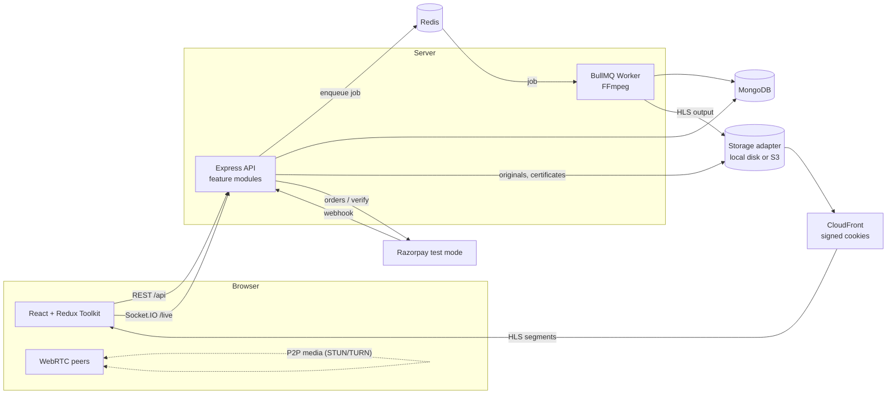
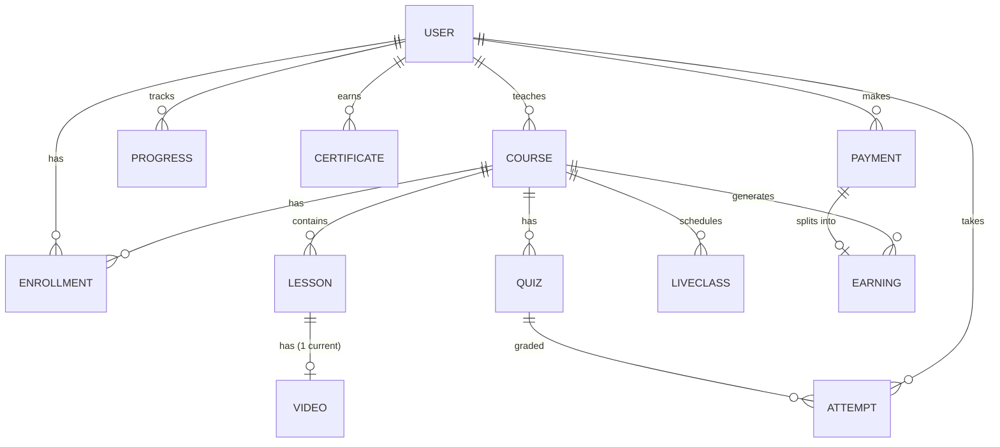
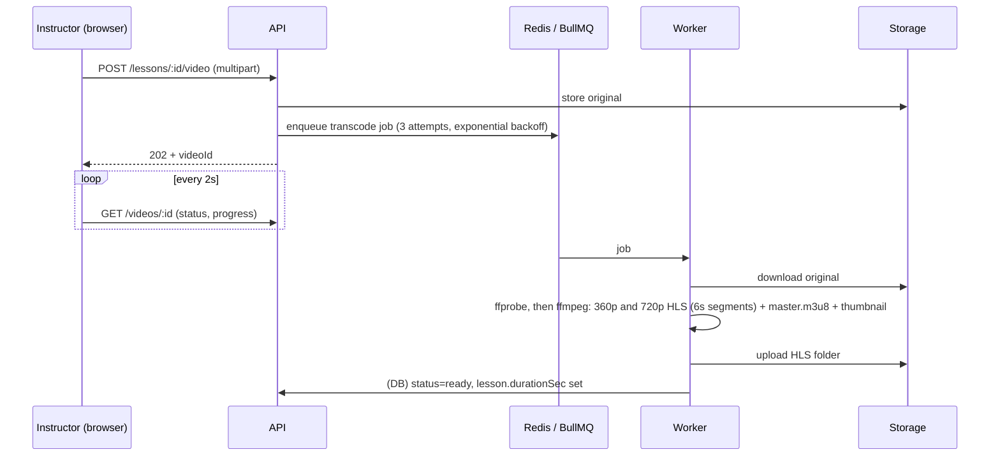

# Architecture

## Style: feature-based monolith

One deployable Express app and one React app. Inside the server every feature is a self-contained module:

```
server/src/features/<feature>/
  <feature>.routes.js       HTTP routes (thin)
  <feature>.controller.js   request/response mapping (only where a feature is large)
  <feature>.service.js      business logic, the only entry point other features may call
  <feature>.model.js        Mongoose schema(s)
  <feature>.validation.js   zod schemas
  index.js                  the module's public surface
```

Rules: a feature never imports another feature's model, only its `service` (lazy `require` inside functions avoids circular imports). Cross-cutting code lives in `shared/` (errors, auth middleware, storage adapters). This keeps the monolith easy to deploy but lets any feature be extracted into a service later.

The client mirrors it: `client/src/app/slices.js` holds Redux Toolkit slices (auth, catalog, learning, instructor, admin, ui) and `pages/` holds one file per screen.

## Components



## Data model



Key indexes: `Enrollment(user, course)` unique, `Progress(user, course)` unique, `Certificate(user, course)` unique, `Earning.payment` unique, `Payment.orderId` unique. These unique indexes are what make payment, enrollment and certificate issuing idempotent.

## Video pipeline



Playback: `GET /lessons/:id/playback` checks access (enrolled / owner / free preview), then returns a signed session. With CloudFront configured it returns signed cookies scoped to `https://<cdn>/videos/<id>/*` (custom policy). Without it, it returns a short-lived JWT URL served by `/api/media/*`, which rewrites playlists so every segment carries the token.

## Payment flow

1. `POST /courses/:id/payments/order` creates a Razorpay order (amount in paise) and a `Payment(status=created)`.
2. The browser opens Razorpay Checkout; on success it calls `POST /payments/verify` with the signature.
3. The server verifies `HMAC_SHA256(order_id|payment_id, key_secret)` with a timing-safe compare.
4. `markPaid` claims the payment with a conditional update (`status != paid`), then enrolls the student and records an `Earning` (80% instructor / 20% platform). The Razorpay webhook calls the same function, so the verify call and the webhook can both arrive without double enrolling.

## Live classes

Socket.IO namespace `/live` is only a **signaling** channel: `join`, `signal` (SDP offer/answer and ICE candidates relayed to one peer in the same room), `chat`, `media-state`, `peer-joined/left`, `class-ended`. Audio and video flow peer-to-peer. The new joiner creates an offer to every participant already in the room (mesh topology), which is why the room is capped at 7 people. STUN is configured by default; set `TURN_URL`, `TURN_USERNAME`, `TURN_CREDENTIAL` for users behind strict NATs. For larger classes the signaling layer can be swapped for an SFU such as LiveKit.

## Security measures

bcrypt password hashing; short-lived access JWT plus rotating refresh token in an httpOnly cookie (stored hashed); identical error for unknown email and wrong password; rate limiting on auth; zod validation on every write; Helmet; CORS allow-list; role-based authorization; ownership checks on every instructor action; quiz answers never sent to students; path-traversal protection in local storage; signed, scoped, expiring media URLs; escaped regex in search; HMAC verification for payments and webhooks.
